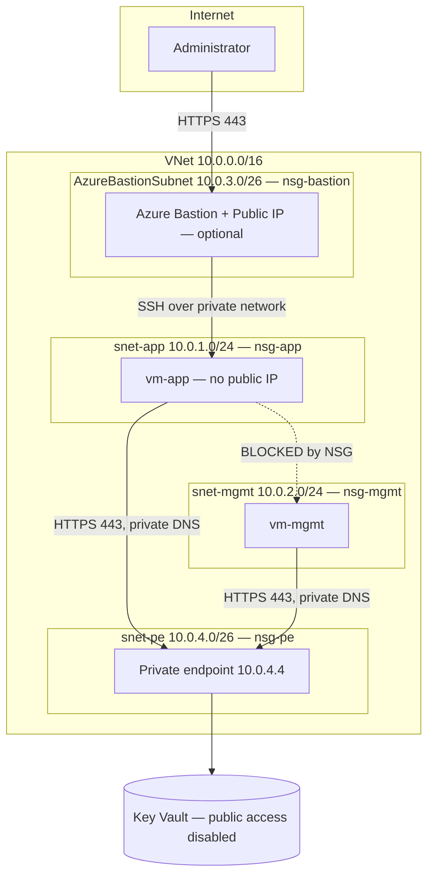

# SecureNet — Segmented Azure Network Foundation (Terraform)

[](https://github.com/jeromendezb/azure-securenet-foundation/actions/workflows/terraform-ci.yml)

Infrastructure-as-Code foundation for a segmented Azure network where **no virtual
machine exposes a management port to the Internet**. Built with Terraform, following
the Microsoft Cloud Adoption Framework (CAF) naming convention.

## Business scenario

A fintech client needs a cloud network for a new workload. Their security
requirements:

- Workload servers must not be reachable from the Internet.
- Administrators must still be able to connect to those servers.
- The application tier must not be able to reach the management tier.
- Everything must be reproducible and auditable — no manual changes in the Portal.

This repository is the network foundation that satisfies those requirements.

## Architecture



| Resource | Name | Purpose |
|---|---|---|
| Resource group | `rg-securenet-dev-eus-001` | Container for all resources |
| Virtual network | `vnet-securenet-dev-eus-001` | `10.0.0.0/16` address space |
| Subnet | `snet-app` (`10.0.1.0/24`) | Application workloads |
| Subnet | `snet-mgmt` (`10.0.2.0/24`) | Management tier |
| Subnet | `AzureBastionSubnet` (`10.0.3.0/26`) | Required name and size for Azure Bastion |
| Subnet | `snet-pe` (`10.0.4.0/26`) | Private endpoints |
| NSG | `nsg-app-securenet-dev-eus-001` | Blocks management ports from the Internet |
| NSG | `nsg-mgmt-securenet-dev-eus-001` | Blocks all traffic coming from `snet-app` |
| NSG | `nsg-pe-securenet-dev-eus-001` | Allows HTTPS to the private endpoint only from `snet-app` and `snet-mgmt` |
| NSG | `nsg-bastion-securenet-dev-eus-001` | The inbound and outbound rules Azure Bastion requires, and nothing else |
| Bastion + Public IP | `bas-securenet-dev-eus-001` | Optional (`enable_bastion`, off by default). Administrative access without public IPs on VMs |
| VM | `vm-app-securenet-dev-eus-001` | Ubuntu 24.04 LTS, SSH key authentication only |
| VM | `vm-mgmt-securenet-dev-eus-001` | Management tier. Identity with no vault role (negative control) |
| Key Vault | `kv-securenet-dev-eus-001` | Stores the application secret. RBAC authorization mode, public network access disabled |
| Private endpoint | `pe-kv-securenet-dev-eus-001` | Private IP for the Key Vault inside `snet-pe` |
| Private DNS zone | `privatelink.vaultcore.azure.net` | Resolves the vault name to its private IP inside the VNet |
| DNS zone VNet link | `pdzvlink-kv-securenet-dev-eus-001` | Makes the VNet use the private DNS zone |
| Key Vault diagnostic setting | `diag-securenet-dev-eus-001` | Sends Key Vault audit logs (`AuditEvent`) to the monitoring workspace in `governance/` |

## Security controls

**No public IP on workload VMs.** The network interface intentionally omits
`public_ip_address_id`. Administrative access goes through Azure Bastion over HTTPS,
so port 22 is never exposed to the Internet — one of the two most scanned ports for
brute-force attacks, with RDP 3389.

**Lateral movement containment.** By default, Azure allows all traffic inside a VNet
(rule `AllowVnetInBound`, priority 65000). `nsg-mgmt` overrides it with an explicit
deny at priority 100 for any traffic originating in `snet-app`. If the application
tier is compromised, the attacker cannot pivot into the management tier.

**Guardrail against future misconfiguration.** `nsg-app` explicitly denies TCP 22 and
3389 from the `Internet` service tag at priority 100. The default rules already deny
it, but this rule means a later "temporary" allow rule cannot silently expose
management ports: it would have to be placed above an explicitly named deny rule,
which is visible in code review and in the Git history.

**Every subnet has an NSG.** `AzureBastionSubnet` carries the exact rule set
Microsoft documents for Bastion: HTTPS from the Internet for operators,
`GatewayManager` and `AzureLoadBalancer` for the control plane and health probes,
and outbound SSH/RDP only towards the VNet. Missing any of them breaks Bastion,
so the rules are copied from the documentation, not designed
([evidence](docs/evidence/bastion-subnet-nsg-test.md)).

**Key-based authentication only.** `disable_password_authentication = true`. The
public key is read from the local filesystem at plan time, so no key material is
stored in this repository.

**Tested emergency access.** If Bastion is unavailable, the SSH key is lost or
SSH stops answering inside the VM, access is recovered without opening any port:
`az vm run-command` and the VMAccess extension work through the Azure VM agent,
and boot diagnostics show the boot log without logging in. Serial Console is
intentionally not used: it would need a local password on the VMs. The procedure
is a [runbook](docs/runbooks/break-glass-vm-access.md), and every case except the
last-resort repair VM was tested ([evidence](docs/evidence/break-glass-test.md)).

**Everything tagged.** All resources carry `project`, `environment`, `owner` and
`managed_by = terraform`, enabling cost allocation per project and signalling that
resources must not be modified manually.

## Secrets management

The application VM needs a database password. Instead of storing it on the VM or
in code, it lives in Azure Key Vault. The VM holds no credential to reach the vault:
it authenticates at runtime with its own managed identity.

| Resource | Purpose |
|---|---|
| `azurerm_key_vault.main` | Stores the secret. RBAC authorization mode, 7-day soft delete |
| Managed identity on `vm-app` | Authenticates the VM to Entra ID with no stored credential |
| `app_kv_secrets_user` role assignment | `Key Vault Secrets User`, scoped to this vault only |
| Managed identity on `vm-mgmt` | Control identity with no vault role, used to prove RBAC denies access |
| `operator_kv_secrets_officer` role assignment | Lets the identity running Terraform create secrets |

The secret value is created with Azure CLI, outside Terraform, so it never
reaches the state file.

**Verified** ([evidence](docs/evidence/keyvault-access-test.md)): no token →
401, identity without role → 403 `ForbiddenByRbac`, application identity → 200.

**Audit logging:** every secret read is logged to the Log Analytics workspace
of the monitoring layer (`AuditEvent`), including requests rejected at the
network layer. Query: [`kv-secret-reads.kql`](queries/kv-secret-reads.kql).

**Network isolation:** the vault only accepts traffic through its private
endpoint (`public_network_access_enabled = false`, network ACL default
`Deny`, no trusted-service bypass). A valid identity is not enough from the
Internet: requests are rejected with `403 ForbiddenByConnection` before
identity is evaluated. Operators write secrets from `vm-mgmt` inside the VNet
([ADR-002](docs/adr/adr-002-keyvault-secret-write-access.md)).
Verified ([evidence](docs/evidence/keyvault-private-endpoint-test.md)),
including the failure mode when the private DNS zone is not linked to the VNet.

Inside the VNet, `nsg-pe` allows HTTPS to the private endpoint only from
`snet-app` and `snet-mgmt`; traffic from any other subnet is dropped
([evidence](docs/evidence/pe-subnet-nsg-test.md)).

## Governance

The fix for the public Key Vault (SEC-014) only covered the vault this repository
deploys. A guardrail prevents the same misconfiguration anywhere in the
subscription:

| Policy | Scope | Effect |
|---|---|---|
| Azure Key Vault should disable public network access (built-in) | Subscription | `Deny` |

Any request to create or update a Key Vault with public network access is
rejected with `RequestDisallowedByPolicy`, including requests from an `Owner`.
RBAC decides *who* can act; Policy decides *what* the result is allowed to look like.

The guardrail lives in [`governance/`](governance/), a separate Terraform root
with its own state. Destroying the lab never removes it. The effect was rolled
out as `Audit` first and switched to `Deny` once no non-compliant vaults remained
([ADR-003](docs/adr/adr-003-subscription-guardrails.md),
[evidence](docs/evidence/policy-kv-public-access-test.md)).

## Detection

Prevention alone does not show who is trying to get around it. A persistent
monitoring layer in [`governance/`](governance/) collects the logs and raises
incidents in Microsoft Sentinel
([ADR-004](docs/adr/adr-004-detection-with-sentinel.md)).

| Resource | Name | Purpose |
|---|---|---|
| Resource group | `rg-securenet-monitoring-dev-eus-001` | Monitoring layer, separate from the workload |
| Log Analytics | `log-securenet-dev-eus-001` | 90-day retention, shared-key access disabled (Entra ID only), 1 GB/day cap (lab) |
| Diagnostic setting | `diag-activity-log-to-law` | Subscription Activity Log, all categories, to the workspace |
| Microsoft Sentinel | on `log-securenet-dev-eus-001` | Runs the analytics rules below and manages incidents |

| Rule | Logic | Severity | Triage question |
|---|---|---|---|
| Run Command executed | Every `RUNCOMMAND/ACTION` ending in `Success` or `Failure` | High | Is there an open ticket (test or break-glass) that explains it? |
| Repeated Key Vault access denials | 5 or more `403` from the same identity in 10 minutes | Medium | Is the identity known, and did a recent change break its network path or role? |

The workspace lives outside the workload root so that `terraform destroy`
never deletes the logs that explain what happened. A single `403` does not
alert: one misconfiguration produces one on every retry, as the missing DNS
link did during the private endpoint test.

Both rules were tested end to end with real events: each produced an
incident in Sentinel, which was triaged and closed with a reference to the
ticket ([evidence](docs/evidence/sentinel-detection-test.md)).

## Continuous integration

Every pull request to `main` runs two jobs from [`terraform-ci.yml`](.github/workflows/terraform-ci.yml):

| Job | Step | What it catches |
|---|---|---|
| Validate Terraform | `terraform fmt -check -recursive` | Non-standard formatting |
| | `terraform init -backend=false` | Provider download issues, without touching state or Azure |
| | `terraform validate` | Syntax errors, invalid arguments, undeclared references |
| | `init` + `validate` in `governance/` | The same checks for the guardrail configuration |
| Checkov scan | Checkov 3.2.20 (pinned) | Security misconfigurations in the Terraform code |

Checkov findings were triaged: accepted risks carry a written justification
in the code (`#checkov:skip`), and pending fixes are marked `TEMPORARY` with
a link to their issue.

The `protect-main` ruleset requires both checks to pass, requires a pull
request for every change to `main`, and blocks force pushes and branch
deletion. It has no bypass list.

Negative tests:
- PR #3: a broken resource reference made **Validate Terraform** fail; merge blocked.
- A test PR that added a rule opening SSH to the Internet made **Checkov scan** fail; merge blocked.

No Azure credentials are stored in GitHub. Running `terraform plan` in CI
is planned using OIDC federated credentials.

## Repository layout

```
.
├── .github/workflows/
│   └── terraform-ci.yml         # CI: fmt, validate and Checkov on every PR
├── governance/                  # Long-lived layer: Azure Policy, Log Analytics, Sentinel. Separate state
├── providers.tf                 # Provider and version pinning
├── variables.tf                 # Inputs and naming/tagging locals
├── main.tf                      # Network, NSGs, Bastion, VMs, Key Vault, Key Vault diagnostic setting
├── scripts/
│   ├── bootstrap-state.ps1      # Creates the storage account for the Terraform state (run once)
│   ├── test-kv-access.sh        # Key Vault access test, run inside the VMs
│   ├── test-kv-network.sh       # Network reachability test to the private endpoint
│   └── check-ssh-port.sh        # SSH reachability check used by the break-glass runbook
├── queries/
│   └── kv-secret-reads.kql      # Audit query for secret reads
└── docs/
    ├── adr/                     # Architecture decision records
    ├── evidence/                # Test results backing each security claim
    ├── incidents/               # Incident reports from real failures
    └── runbooks/                # Operational procedures (break-glass access)
```

## Prerequisites

- Terraform `>= 1.16, < 2.0` (enforced by `required_version`; CI runs 1.16.2) with the `azurerm` provider `~> 3.0`
- Azure CLI
- An Azure subscription with quota for a general-purpose VM family
- An SSH key pair:

```bash
ssh-keygen -t rsa -b 4096 -f ~/.ssh/securenet_lab
```

## Deployment

**Current state (lab):** deployments run from the operator's workstation using
the operator's Azure CLI session. When no `ARM_*` environment variables are
set, the azurerm provider falls back to Azure CLI credentials.

Deploy in this order. The workload looks up the monitoring workspace with a
`data` source, so `governance/` must exist first; otherwise `plan` fails
with "not found".

**0. State storage** (once, before the first `terraform init`):

```powershell
.\scripts\bootstrap-state.ps1
```

Both roots keep their state in Azure Storage, not on the workstation
([ADR-005](docs/adr/adr-005-remote-state.md)). The backend reads its
configuration before Terraform can create anything, so the storage account
is created by this script instead of by Terraform. The script is safe to run
again.

| Root | State file in container `tfstate` |
|---|---|
| Workload (repository root) | `workload.tfstate` |
| `governance/` | `governance.tfstate` |

The storage account accepts Entra ID only (shared keys disabled), keeps
previous versions of each state file, and recovers deleted files for 7 days.
The backend locks the state during every run, so two runs cannot overwrite
each other.

**1. Governance and monitoring** (once; not destroyed with the lab):

```powershell
az login
az account show   # confirm which identity will run Terraform
terraform -chdir=governance init
terraform -chdir=governance apply
```

**2. Workload** (each lab session):

```powershell
terraform init
terraform fmt -check
terraform validate
terraform plan -out=tfplan
terraform apply tfplan
```

After `apply`, `terraform plan` must report `No changes`. Values that Azure
sets on its own after creation are declared in the code instead of ignored
with `ignore_changes`, so a manual change to them still shows up as drift.

Azure Bastion is disabled by default because it bills hourly. Enable it only
when interactive access is needed: `terraform apply -var="enable_bastion=true"`.

**Why not the Service Principal:** this configuration creates role
assignments (`Microsoft.Authorization/roleAssignments/write`). The existing
Service Principal has `Contributor`, which cannot create role assignments,
so `apply` would fail with `403 AuthorizationFailed`. Granting it `Owner`
would let an automation credential give any role to anyone, so that option
was rejected.

**Target state:** deployments move to the CI pipeline using an OIDC federated
identity (no stored secret), with `Role Based Access Control Administrator`
restricted by a condition to the specific roles this configuration assigns.

## Verification

```bash
# Every subnet has an NSG attached (no row should show an empty NSG column)
az network vnet subnet list -g rg-securenet-dev-eus-001 \
  --vnet-name vnet-securenet-dev-eus-001 \
  --query "[].{subnet:name, nsg:networkSecurityGroup.id}" -o table

# The VM has no public IP
az vm list-ip-addresses -g rg-securenet-dev-eus-001 \
  -n vm-app-securenet-dev-eus-001 -o table
```

An NSG that exists but is not associated with a subnet protects nothing — that is why
the association is verified explicitly, not assumed.

## Cost and teardown

| Resource | Approx. cost |
|---|---|
| VNet, subnets, NSGs | Free |
| Azure Bastion (Basic), only when `enable_bastion = true` | ~$0.19 / hour |
| Bastion public IP (Standard), only when `enable_bastion = true` | ~$0.005 / hour |
| VMs (2 × 2 vCPU general purpose) | ~$0.10 / hour each |
| Key Vault (Standard) | Per operation; negligible at lab volume |
| Private endpoint | ~$0.01 / hour, plus data processed |
| Private DNS zone | Small fixed monthly fee per zone |
| Log Analytics (`governance/`, always on) | Per GB ingested; no cost without data; capped at 1 GB/day |
| Microsoft Sentinel | 31-day free trial (10 GB/day); then per GB analyzed. `AzureActivity` is free |
| State storage account (always on) | Cents per month for a few kilobytes of state |

Bastion bills per hour whether or not it is used. The lab is designed to be deployed,
verified, and destroyed in the same session:

```bash
terraform destroy
```

`terraform destroy` in the root removes only the workload. The monitoring
layer and the policy in `governance/` stay, on purpose.

## Known limitations

- **The state storage account is reachable from the Internet.** It is protected
  by identity (Entra ID only, role scoped to the account), not by network,
  because Terraform runs from the workstation and from CI. A private endpoint
  with a runner inside the VNet is the production target
  ([ADR-005](docs/adr/adr-005-remote-state.md)).
- **The OS image uses `version = "latest"`.** Convenient for a lab; production pins an
  exact image version so deployments stay reproducible.
- **Writing a secret requires Bastion and an interactive session on `vm-mgmt`.**
  Accepted for the lab ([ADR-002](docs/adr/adr-002-keyvault-secret-write-access.md));
  production target is a VPN or a CI runner inside the VNet.
- **Incidents carry no entities.** The rules do not map columns to accounts, IPs
  or resources yet, so the analyst reads them from the raw events. Tracked as SEC-017.
- **The 403 threshold is not baselined.** Five denials in ten minutes is a
  conservative starting value, not measured against normal traffic.
- **No notification.** Incidents are created in Sentinel, but no automation
  sends them anywhere; someone has to look.
- **Detection delay of 7 to 10 minutes** between the event and the incident in
  the tests, from log ingestion plus the rule schedule.
- **One guardrail only.** Azure Policy covers Key Vault public network access;
  other services that can be exposed (Storage, SQL) are not covered yet.
- **Repair VM recovery is documented but untested.** If the VM agent is down,
  `run-command` and VMAccess cannot help; the runbook's last resort
  (`az vm repair`) has not been exercised in this lab.
- **`run-command` is root access.** Any role with
  `Microsoft.Compute/virtualMachines/runCommand/action`, including
  Virtual Machine Contributor, can run commands as root. It is detected
  (every execution raises a High incident), not prevented.
- **Key Vault purge protection is disabled.** Lab only, so the vault can be redeployed.

## Evidence

- [Network segmentation and administrative access](docs/evidence/segmentation-test.md)
- [Key Vault access control (401 / 403 / 200) and audit logs](docs/evidence/keyvault-access-test.md)
- [Key Vault private endpoint and private DNS (before / after VNet link)](docs/evidence/keyvault-private-endpoint-test.md)
- [Private endpoint subnet NSG (allowed vs blocked subnets)](docs/evidence/pe-subnet-nsg-test.md)
- [Bastion subnet NSG (required rules, working SSH session)](docs/evidence/bastion-subnet-nsg-test.md)
- [Azure Policy: Key Vault public access denied at subscription scope](docs/evidence/policy-kv-public-access-test.md)
- [Break-glass access: recovery without SSH or Bastion](docs/evidence/break-glass-test.md)
- [Sentinel detection: run-command and repeated Key Vault denials](docs/evidence/sentinel-detection-test.md)
- [Terraform state migrated to Azure Storage without recreating resources](docs/evidence/remote-state-migration.md)

## Incidents

Real failures encountered while building this, diagnosed and documented:

- [INC-001 — Partial Terraform apply during naming refactor](docs/incidents/2026-09-inc-001-partial-apply.md)

## Next steps

- Deploy from CI with OIDC federated credentials.
- Entity mapping on the Sentinel rules (SEC-017).
- Notify on new incidents with a Sentinel automation rule.
- Detect deletion of policy assignments, the way an `Owner` would bypass the guardrail.
- Microsoft Defender for Cloud (free tier) for posture recommendations.